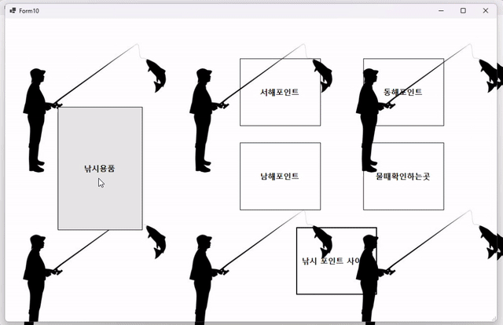
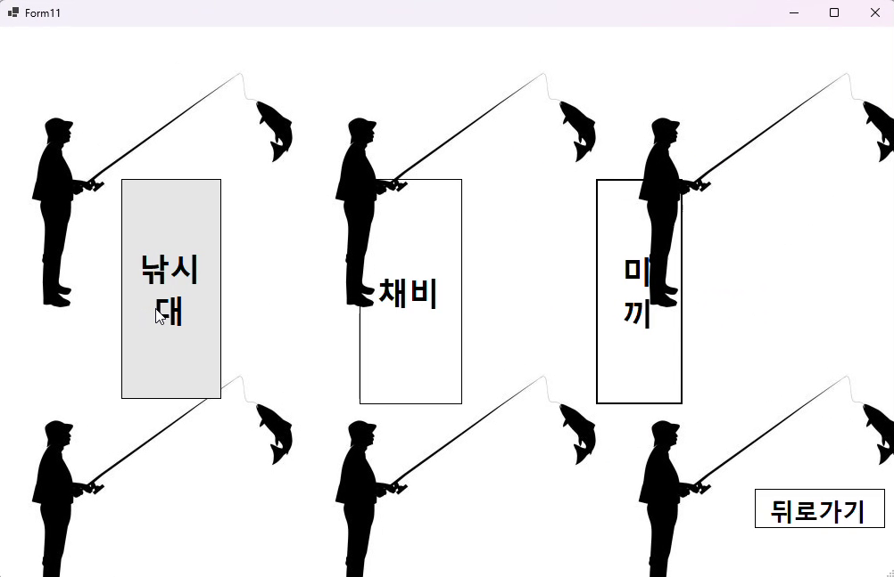
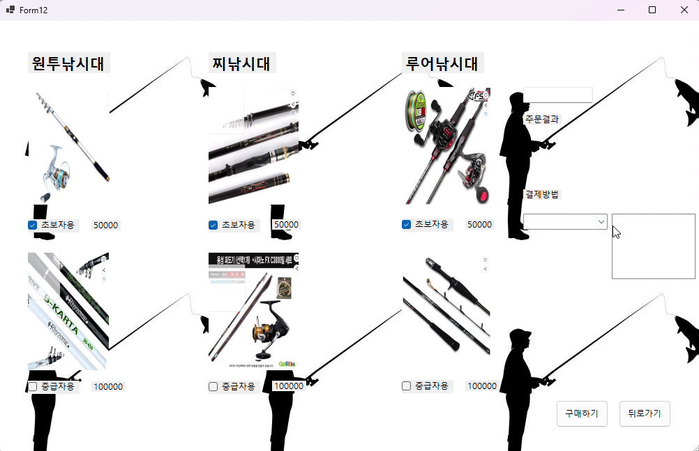
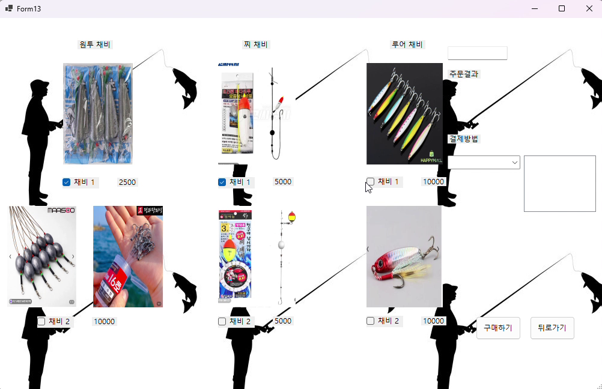
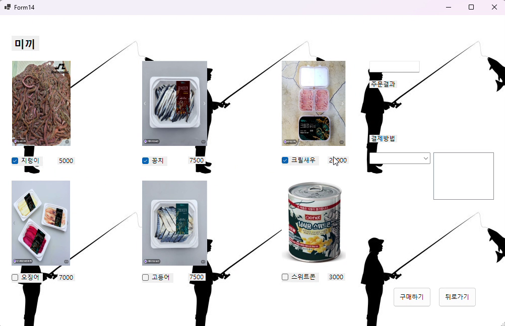
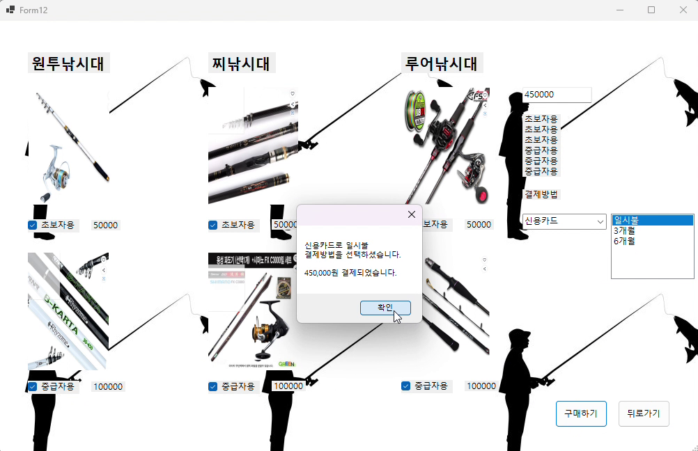
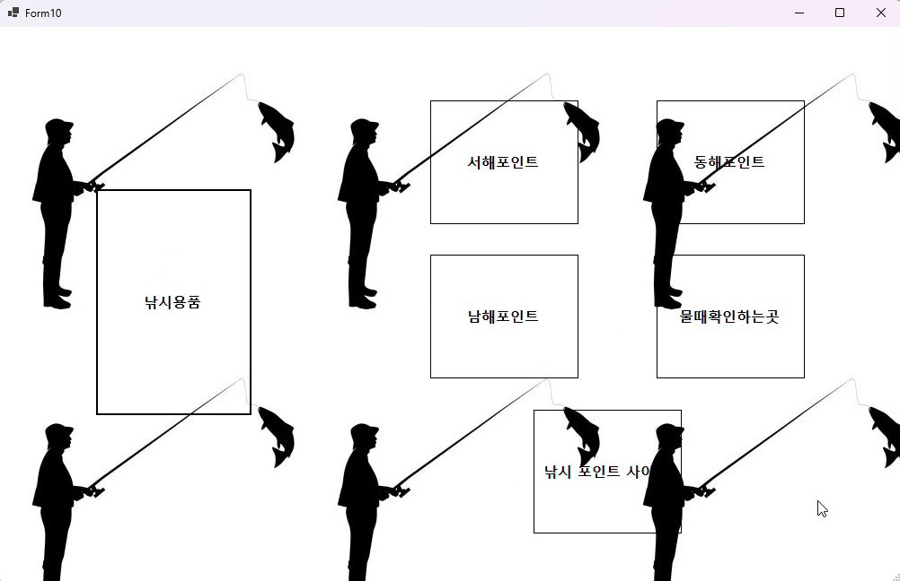
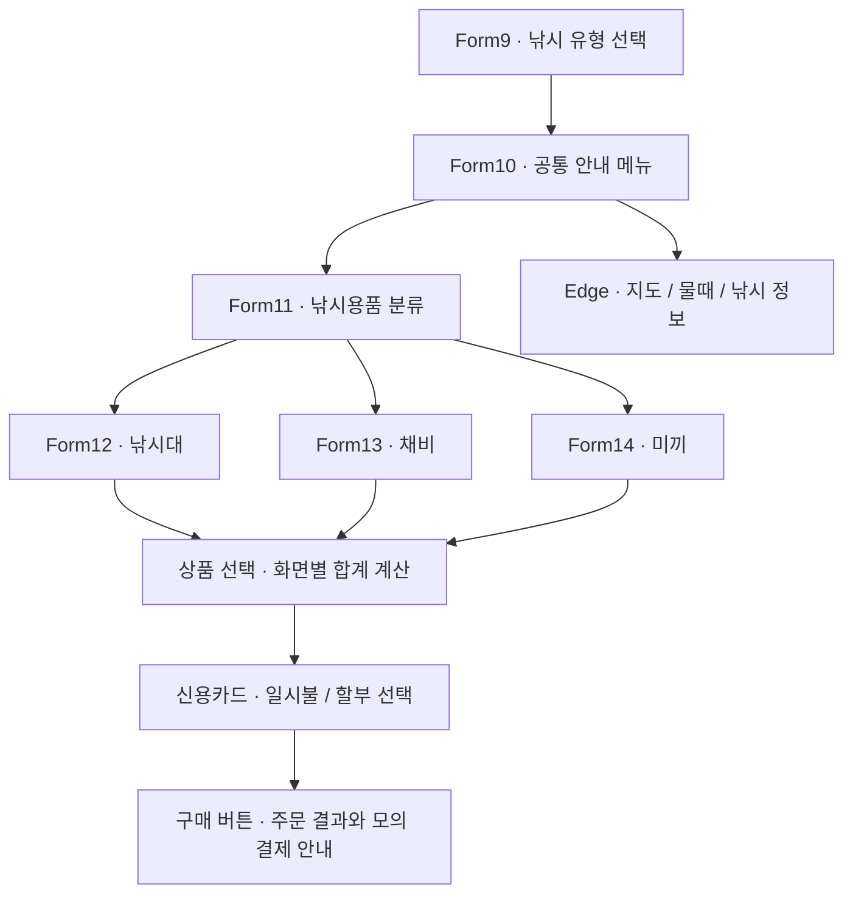

# 🎣 FISHING KIOSK

### C# WinForms로 구현한 낚시 안내 · 낚시용품 주문 키오스크


**낚시 유형 선택부터 낚시 포인트 확인, 용품 선택, 주문 금액 계산, 모의 결제까지 연결하는 Windows 데스크톱 프로젝트입니다.**

[프로젝트 개요](#-프로젝트-개요) · [시연 영상](#-시연-영상) · [주요 기능](#-주요-기능) · [화면 구성](#-화면-구성) · [실행 방법](#-환경-설정-및-실행)

---

## 📌 프로젝트 개요

낚시에 필요한 정보를 찾아보고 용품을 선택할 수 있도록 구성한 **낚시 안내 및 용품 주문 키오스크**입니다.

C#의 이벤트 처리와 Windows Forms의 화면 전환을 활용해, 원투·루어·찌 낚시 선택 화면과 안내 메뉴, 낚시대·채비·미끼 주문 화면을 구현했습니다. 상품을 선택하거나 해제하면 합계가 변경되고, 구매 버튼을 누르면 선택 목록과 결제 안내를 확인할 수 있습니다.

| 항목 | 내용 |
| --- | --- |
| 개발자 | 조영준 |
| 프로젝트 유형 | Windows 데스크톱 키오스크 |
| 개발 언어 | C# |
| UI | Windows Forms |
| 대상 프레임워크 | .NET 6.0 Windows (`net6.0-windows`) |
| 화면 구성 | 6개 Form: 시작, 안내, 용품 분류, 낚시대, 채비, 미끼 |
| 데이터 처리 | 화면별 메모리에서 상품 선택 상태와 합계 관리 |
| 결제 범위 | 신용카드·할부 선택 UI 및 결제 완료 메시지 표시 **(모의 결제)** |

> 실제 카드 승인, 결제 서버, 주문 DB와 연동하지 않는 데모 프로젝트입니다.

## 🎥 시연 영상

[](demo/kiosk-demo.mp4)

**[▶ 전체 시연 영상 보기 / 다운로드](demo/kiosk-demo.mp4)**

- 제공된 화면 녹화를 바탕으로 정리한 약 **1분 18초**의 무음 영상입니다.
- 용품 분류 → 낚시대·채비·미끼 선택 → 모의 결제 → 낚시 정보 사이트 이동 과정을 보여줍니다.
- 위 GIF는 영상 앞부분의 용품 주문 과정을 빠르게 보여주는 미리보기입니다.

---

## ⚙️ 주요 기능

### 1. 낚시 유형 선택과 화면 전환

| 기능 | 설명 |
| --- | --- |
| 낚시 유형 선택 | 원투 낚시 · 루어 낚시 · 찌 낚시 버튼 제공 |
| 안내 메뉴 이동 | 세 유형 버튼 모두 공통 안내 화면으로 이동 |
| 화면 위치 유지 | 다음 Form에 현재 화면의 크기와 위치를 전달 |
| 단계별 이동 | `ShowDialog()`로 하위 화면을 열고, 뒤로가기에서 해당 화면을 닫음 |

### 2. 낚시 포인트와 외부 정보 안내

| 메뉴 | 동작 |
| --- | --- |
| 서해·동해·남해 포인트 | 각 버튼에 지정된 네이버 지도 장소 링크 열기 |
| 물때 확인 | 바다타임 웹사이트 열기 |
| 낚시 포인트 사이트 | 낚시 포인트 안내 웹사이트 열기 |
| 낚시용품 | 낚시대·채비·미끼 분류 화면으로 이동 |

외부 사이트는 `Process.Start()`로 Microsoft Edge를 실행해 표시합니다. 앱 내부에 지도를 삽입하거나 실시간 데이터를 수집하는 방식은 아닙니다.

### 3. 낚시용품 선택과 금액 계산

| 분류 | 구성 | 금액 범위 |
| --- | --- | --- |
| 낚시대 | 원투·찌·루어 × 초보자용·중급자용, 총 6개 선택 항목 | 50,000원 / 100,000원 |
| 채비 | 원투·찌·루어 × 채비 1·2, 총 6개 선택 항목 | 2,500원 ~ 10,000원 |
| 미끼 | 지렁이, 꽁치, 크릴새우, 오징어, 고등어, 스위트콘 | 3,000원 ~ 20,000원 |

- 상품 이미지와 가격을 함께 표시합니다.
- 체크박스 선택 시 가격을 더하고, 선택 해제 시 해당 가격을 뺍니다.
- 구매 버튼을 누르면 선택 항목을 주문 결과에, 합계를 금액 입력란에 표시합니다.
- 합계는 각 주문 화면에서 독립적으로 관리하며, 서로 다른 분류를 합치는 공통 장바구니는 없습니다.

### 4. 모의 결제 안내

| 기능 | 설명 |
| --- | --- |
| 결제 수단 선택 | ComboBox에서 신용카드 선택 |
| 결제 방식 선택 | ListBox에서 일시불 · 3개월 · 6개월 선택 |
| 결제 결과 안내 | 선택한 방식과 합계 금액을 MessageBox에 표시 |
| 금액 표현 | 결제 완료 메시지에 천 단위 구분 기호 적용 |

---

## 🖼️ 화면 구성

아래 이미지는 제공된 시연 영상에서 추출한 실제 프로젝트 화면입니다.

| 용품 분류 | 낚시대 선택 |
| :---: | :---: |
|  |  |
| **채비 선택** | **미끼 선택** |
|  |  |
| **모의 결제 결과** | **낚시 정보 안내** |
|  |  |

## 🔄 화면 흐름



## 🛠️ 기술 스택

| 분류 | 사용 기술 |
| --- | --- |
| 언어 / 런타임 | C#, .NET 6.0 Windows |
| UI | Windows Forms, Visual Studio Designer |
| 화면 요소 | Button, Label, PictureBox, CheckBox, ComboBox, ListBox, TextBox |
| 이벤트 처리 | `Click`, `CheckedChanged`, `SelectedIndexChanged` |
| 이미지 리소스 | Form별 `.resx`에 이미지 포함 |
| 외부 프로그램 연동 | `System.Diagnostics.Process`, Microsoft Edge |
| 버전 관리 | Git, GitHub |

## 📁 프로젝트 구조

```text
C-winfrom-kiosk/
├── README.md                     # 프로젝트 소개와 실행 안내
├── .gitignore                    # 빌드 결과물·개인 설정 제외
├── src/
│   ├── pro.sln                   # Visual Studio 솔루션
│   └── pro/
│       ├── pro.csproj            # net6.0-windows / WinForms 설정
│       ├── Program.cs            # 시작 지점: Form9 실행
│       ├── Form9.cs              # 낚시 유형 선택
│       ├── Form10.cs             # 안내 메뉴와 외부 링크
│       ├── Form11.cs             # 낚시용품 분류
│       ├── Form12.cs             # 낚시대 선택·주문
│       ├── Form13.cs             # 채비 선택·주문
│       ├── Form14.cs             # 미끼 선택·주문
│       ├── Form*.Designer.cs     # 각 화면의 컨트롤과 배치
│       └── Form*.resx            # 배경·상품 이미지
├── docs/
│   ├── DEVELOPMENT.md            # 핵심 코드 설명과 검증 기록
│   └── images/                  # 시연 화면 이미지 6장
└── demo/
    ├── kiosk-demo.mp4            # 전체 시연 영상
    └── preview.gif               # 주문 과정 미리보기
```

## 🔧 환경 설정 및 실행

### 준비 사항

- Windows PC
- Visual Studio 2022: **.NET 데스크톱 개발** 워크로드 및 .NET 6 대상 지정 구성 요소
- 명령줄 빌드 시 .NET SDK와 .NET 6 Windows Desktop 대상 참조 팩
- 실행 시 **.NET 6 Windows Desktop Runtime**
- 외부 정보 메뉴 사용 시 Microsoft Edge와 인터넷 연결

> 원본 프로젝트의 .NET 6 타깃을 유지했습니다. 현재 SDK에서는 지원 종료 경고(`NETSDK1138`)가 출력됩니다. 프레임워크 업그레이드는 향후 개선 항목입니다.

### Visual Studio에서 실행

1. 저장소를 클론하거나 ZIP으로 내려받아 압축을 해제합니다.
2. `src/pro.sln`을 Visual Studio에서 엽니다.
3. 필요하면 위 준비 사항의 구성 요소를 설치합니다.
4. 시작 프로젝트를 `pro`로 선택합니다.
5. **F5** 또는 **Ctrl + F5**를 눌러 실행합니다.

### PowerShell에서 실행

```powershell
git clone https://github.com/joyeongjun/C-winfrom-kiosk.git
cd C-winfrom-kiosk
dotnet build src/pro.sln --configuration Release
dotnet run --project src/pro/pro.csproj --configuration Release
```

이미 저장소를 내려받았다면 해당 폴더에서 마지막 두 명령어만 실행하면 됩니다.

### 사용 순서

1. 원투·루어·찌 낚시 중 하나를 선택합니다.
2. 안내 화면에서 **낚시용품**을 누릅니다.
3. **낚시대 / 채비 / 미끼** 중 하나를 선택합니다.
4. 구매할 상품을 체크합니다.
5. 결제 수단 **신용카드**와 **일시불 / 3개월 / 6개월** 중 하나를 선택합니다.
6. **구매하기**를 눌러 주문 결과, 합계와 모의 결제 메시지를 확인합니다.
7. **뒤로가기**로 이전 화면으로 돌아갑니다.

## 🧩 현재 구현 범위와 개선 계획

| 현재 구현 | 향후 개선 방향 |
| --- | --- |
| 세 낚시 유형에서 같은 안내 화면 사용 | 유형별 상품 추천과 포인트 안내 |
| 화면마다 별도 합계 관리 | 공통 장바구니와 수량 조절 |
| 화면의 가격 Label을 숫자로 변환 | 상품 모델과 데이터 저장소 분리 |
| 카드 선택 및 완료 메시지 표시 | 빈 주문·미선택 결제 정보 검증 보강 |
| Edge 실행 경로가 코드에 고정됨 | 기본 브라우저 사용과 실행 실패 처리 |
| 주문을 메모리에서만 처리 | 주문 이력·재고 DB 및 영수증 기능 |

현재 결제 입력 검증은 단일 공백 문자열과의 비교이므로, 빈 입력을 완전히 차단하지 못합니다. 실행 시에는 상품과 결제 정보를 모두 선택하세요. 실제 결제 연동은 별도 개발이 필요합니다.

## ✅ 검증

- 공개용 소스 복사본에서 **Release 빌드 성공, 오류 0개**를 확인했습니다.
- 원본 C#·Designer·리소스 파일을 유지하고 저장소 폴더 구조를 정리했습니다.
- `bin`, `obj`, `.vs`, 개인별 `.user` 파일과 원본 ZIP은 저장소에서 제외했습니다.
- 화면 이미지는 제공된 시연 녹화 기준이며, 이번 정리 작업에서 모든 화면과 외부 링크를 수동 재검증한 것은 아닙니다.

핵심 이벤트 처리와 빌드 경고의 상세 내용은 [개발 설명](docs/DEVELOPMENT.md)을 참고하세요.

---

README 구성 참고: [ChemiBot-GestureControl](https://github.com/SU-Y0UNG/ChemiBot-GestureControl). 설명과 시연 자료는 이 낚시 키오스크 프로젝트를 기준으로 작성했습니다.
